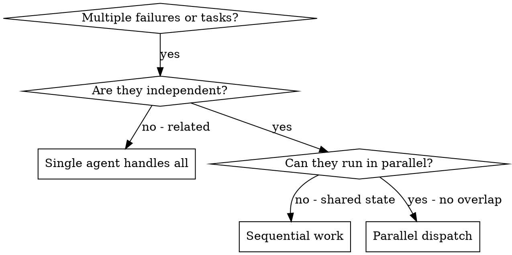

# Dispatching Parallel Agents

## Repository context preflight

Before repository work, read `~/.wonsky-agents/skills/repository-context/SKILL.md` and establish or refresh its scope/context packet. Reuse a valid packet within the same session; delegated agents must receive it and read the applicable guidance. Persistent repository instructions/context may change only under that skill's concrete-proposal approval gate.

When you have **two or more** unrelated failures, investigations, or bounded tasks, handling them one-by-one can waste time. Each stream should be understandable **without** waiting on the others.

**Core principle:** Dispatch **one agent per independent domain**. Let them work concurrently; then integrate and verify.

## When to Use

Use when:

- **2+** independent failures (e.g. different test files, different subsystems)
- **2+** work streams with **disjoint** files or clearly separated concerns
- Several **bounded** research or fix questions that do not block each other
- Each problem can be understood without full cross-context from the others
- **No shared mutable state** and **no overlapping write scopes** between agents



## When NOT to Use

Do **not** parallelize when:

- Failures are **related** (fixing one may fix others — understand together first)
- You need **full system state** in one head to decide anything
- Agents would **interfere** (same files, same resources, conflicting refactors)
- **Exploratory** debugging — you don’t yet know what’s broken
- Uncertainty about overlap is **high** — prefer sequential work

## The Pattern

### 1. Identify Independent Domains

Group work by what’s broken or what’s being delivered:

- Domain A: e.g. tool abort / timing tests
- Domain B: batch completion behavior
- Domain C: approval / race conditions

Each domain should be fixable without touching the others’ core edits.

### 2. Create Focused Agent Tasks

Each agent gets:

- **Specific scope** — one file, subsystem, or narrow question
- **Clear goal** — e.g. “make these tests pass” or “answer this design question”
- **Constraints** — what **not** to change (e.g. production vs test only)
- **Expected output** — summary, root cause, files changed, risks

### 3. Dispatch in Parallel

Launch one agent per domain with **self-contained** prompts (see below). All may run concurrently **only if** scopes are disjoint.

### 4. Review and Integrate

When agents return:

- Read each summary
- Check for **conflicting edits** or contradictory assumptions
- Run **full** verification (test suite, linters, integration checks)
- Integrate; fix any cross-cutting issues sequentially if needed

## Agent Prompt Structure

Good prompts are:

1. **Focused** — one clear problem domain
2. **Self-contained** — enough context to start without the other agents’ transcripts
3. **Specific about output** — what artifacts or summary format you need back

### Example Prompt Template

```markdown
Fix the failing tests in `src/agents/agent-tool-abort.test.ts`:

1. "should abort tool with partial output capture" — [symptom / assertion]
2. "should handle mixed completed and aborted tools" — [symptom / assertion]

Your task:
1. Read the test file and implementation; state the root cause (timing vs logic bug).
2. Fix without widening scope — do not refactor unrelated modules.
3. Prefer event-based waiting over arbitrary sleeps unless project standards say otherwise.

Return:
- Root cause (1–3 sentences)
- Files changed
- How you verified (command + outcome)
```

## Common Mistakes

| Mistake | Better |
|--------|--------|
| Too broad: “Fix all the tests” | Specific file or subsystem |
| No context: “Fix the race” | Paste errors, test names, relevant snippets |
| No constraints | State what must not change |
| Vague output: “Fix it” | Require root cause + changed files + verification |

## Verification After Agents Return

1. **Review each summary** — understand what changed and why
2. **Check for conflicts** — duplicate edits, incompatible approaches
3. **Run full suite** (or agreed integration checks) — fixes must compose
4. **Spot-check** — agents can share blind spots; you own final correctness

## Rules

- One agent per **independent** domain
- Do not parallelize tasks that **depend** on each other’s output
- Do not parallelize implementations that **touch the same files** without a merge strategy
- When in doubt about independence, **go sequential**

## Context handoff

Pass the repository-context packet with every plan or delegated task: repo root, outcome, read/write boundaries, applicable instructions, selected documents and freshness evidence, unresolved conflicts, and exact protected-document approvals. Each fresh worker reads the applicable guidance; a summary is not a replacement. Recheck changed documents on resume and instruction chains for new targets. Do not inherit broader permissions from another worker.
