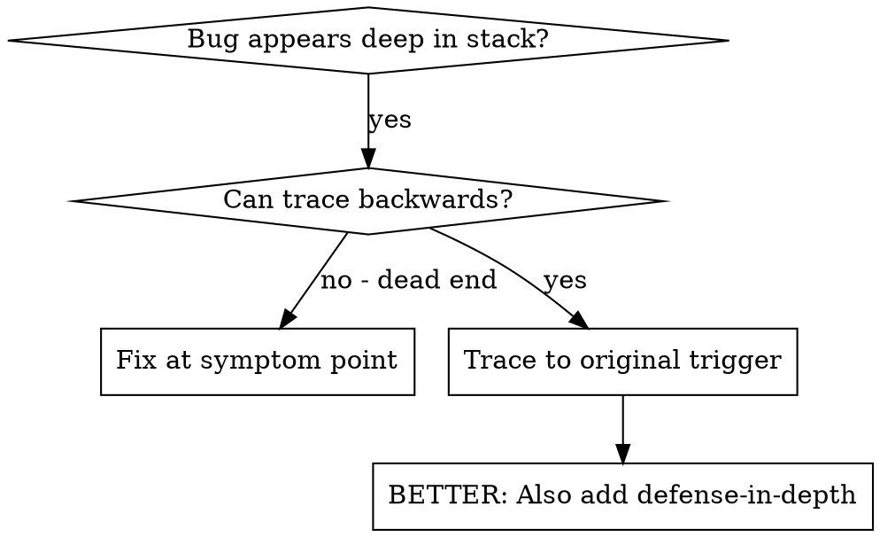
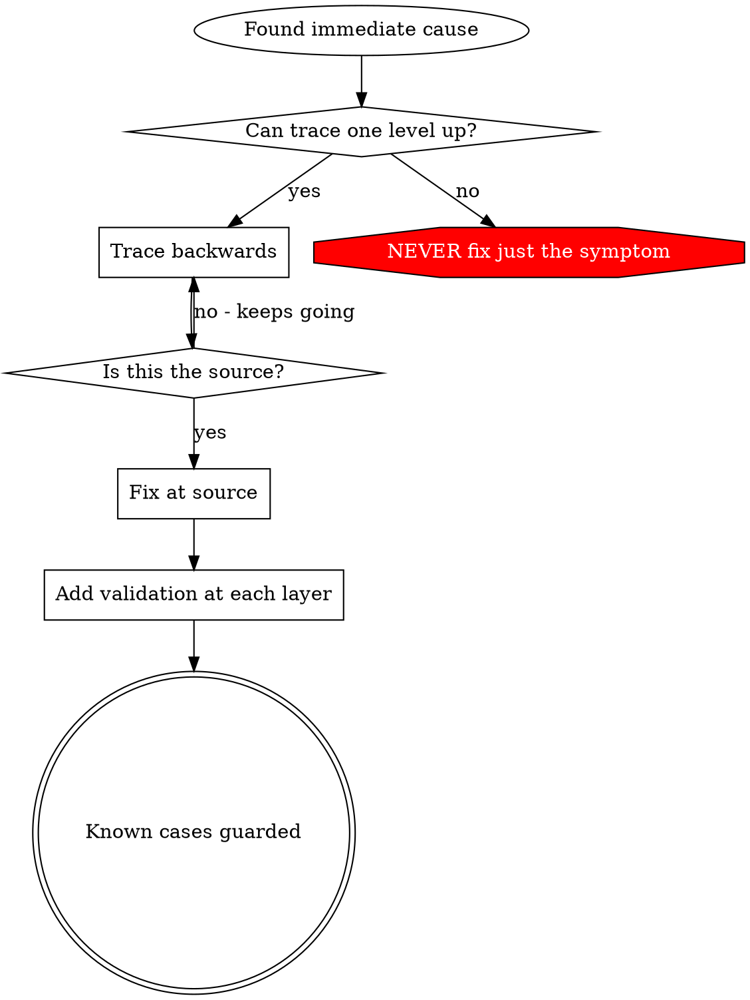

# Root Cause Tracing

## Repository context preflight

Before repository work, read `~/.wonsky-agents/skills/repository-context/SKILL.md` and establish or refresh its scope/context packet. Reuse a valid packet within the same session; delegated agents must receive it and read the applicable guidance. Follow that skill's draft-first context workflow and exact approval gate for existing instructions or proposed policies. A context draft is not an active rule until reviewed.

## Overview

Bugs often manifest deep in the call stack (git init in wrong directory, file created in wrong location, database opened with wrong path). Your instinct is to fix where the error appears, but that's treating a symptom.

**Core principle:** Trace backward through the call chain until you find the original trigger, then fix at the source.

## When to Use



**Use when:**
- Error happens deep in execution (not at entry point)
- Stack trace shows long call chain
- Unclear where invalid data originated
- Need to find which test/code triggers the problem

## The Tracing Process

### 1. Observe the Symptom
```
Error: git init failed in /Users/dev/project/packages/core
```

### 2. Find Immediate Cause
**What code directly causes this?**
```typescript
await execFileAsync('git', ['init'], { cwd: projectDir });
```

### 3. Ask: What Called This?
```typescript
WorktreeManager.createSessionWorktree(projectDir, sessionId)
  → called by Session.initializeWorkspace()
  → called by Session.create()
  → called by test at Project.create()
```

### 4. Keep Tracing Up
**What value was passed?**
- `projectDir = ''` (empty string!)
- Empty string as `cwd` resolves to `process.cwd()`
- That's the source code directory!

### 5. Find Original Trigger
**Where did empty string come from?**
```typescript
const context = setupCoreTest(); // Returns { tempDir: '' }
Project.create('name', context.tempDir); // Accessed before beforeEach!
```

## Adding Stack Traces

When you can't trace manually, add instrumentation:

```typescript
// Before the problematic operation
async function gitInit(directory: string) {
  const stack = new Error().stack;
  console.error('DEBUG git init:', {
    directory,
    cwd: process.cwd(),
    nodeEnv: process.env.NODE_ENV,
    stack,
  });

  await execFileAsync('git', ['init'], { cwd: directory });
}
```

**Critical:** Use `console.error()` in tests (not logger - may not show)

**Run and capture:** When test execution is authorized, use the project runner and retain its actual exit status and full output. Filter a saved log afterward if useful; a successful filter is not a successful test run. Log only approved diagnostic fields, never credential values or complete environment dumps.

**Analyze stack traces:**
- Look for test file names
- Find the line number triggering the call
- Identify the pattern (same test? same parameter?)

## Finding Which Test Causes Pollution

If something appears during tests but you don't know which test:

When test execution is authorized, use the bundled sequential finder with the project's actual single-file runner. Resolve it from this loaded skill directory:

```sh
python3 "<loaded-skill-directory>/find_polluter.py" '.git' 'src/**/*.test.ts' -- npm test -- '{test}'
```

The runner above is an example: confirm how the project accepts a test-file path. The exact `{test}` argument is replaced with each discovered file, without a shell. Python 3.9+ is required; `find-polluter.sh` is a compatibility launcher. Discovery is restricted to the current working tree, supports recursive globs and spaces, and refuses escapes. Use a scoped isolated checkout when the test can mutate repository files.

The helper never deletes existing pollution. It stops at the first newly observed path (exit 1); zero matches, pre-existing pollution and runner failures are incomplete (exit 2). Exit 0 means every selected test-file runner succeeded with the watched path absent; it cannot prove each framework actually selected a test or expose interaction/order-dependent pollution. Inspect the runner output and expand the investigation when the original failure is not reproduced.

## Real Example: Empty projectDir

**Symptom:** `.git` created in `packages/core/` (source code)

**Trace chain:**
1. `git init` runs in `process.cwd()` ← empty cwd parameter
2. WorktreeManager called with empty projectDir
3. Session.create() passed empty string
4. Test accessed `context.tempDir` before beforeEach
5. setupCoreTest() returns `{ tempDir: '' }` initially

**Root cause:** Top-level variable initialization accessing empty value

**Fix:** Made tempDir a getter that throws if accessed before beforeEach

**Also added defense-in-depth:**
- Layer 1: Project.create() validates directory
- Layer 2: WorkspaceManager validates not empty
- Layer 3: NODE_ENV guard refuses git init outside tmpdir
- Layer 4: Stack trace logging before git init

## Key Principle



**NEVER fix just where the error appears.** Trace back to find the original trigger.

## Stack Trace Tips

**In tests:** Use `console.error()` not logger - logger may be suppressed
**Before operation:** Log before the dangerous operation, not after it fails
**Include context:** Approved paths, timestamps and redacted presence/state metadata; omit secrets and complete environment values
**Capture stack:** `new Error().stack` shows complete call chain

## Real-World Impact

Backward tracing consistently finds root causes that symptom-level fixes miss:
- 5-level traces reveal that bugs originate far from where they manifest
- Fixing at source and guarding distinct boundaries can prevent known alternate triggers; verify the cases actually in scope
- Run the relevant authorized checks and report their real coverage; finding a root cause alone does not establish a clean full suite
